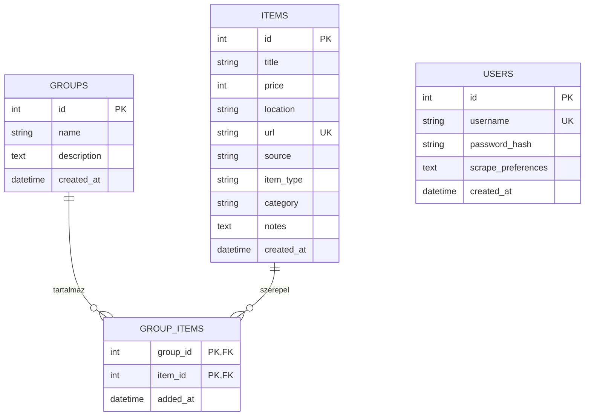

# BikeSeeker

Használt kerékpár- és alkatrészhirdetéseket gyűjtő, kereső és rendszerező full-stack webalkalmazás. Egy scraper letölti a hirdetéseket a [bringakereso.hu](https://bringakereso.hu) oldalról, a FastAPI backend SQLite adatbázisban tárolja őket, a React + TypeScript felületen pedig bejelentkezés után szűrhetők, szerkeszthetők és saját csoportokba rendezhetők.

---

## Főbb funkciók

### Bejelentkezés és munkamenet
- JWT alapú hitelesítés. A jelszavakat bcrypt hash formájában tárolja, a token 24 óráig érvényes.
- Első indításkor létrejön egy bemutató fiók: **`admin` / `admin`**.
- Ha a token lejár vagy érvénytelenné válik, a felület automatikusan visszalép a bejelentkezési képernyőre, és jelzi, hogy a munkamenet lejárt.

### Hirdetések keresése és kezelése
- **Két hirdetéstípus:** komplett kerékpárok (MTB, Trail, Enduro, DH, E-Bike) és alkatrészek (Villa, Váz, Fék, Váltó, Kerékszett, Hajtás).
- **Szűrés:**
  - **Cím:** több szóval is lehet keresni, mindegyik szónak szerepelnie kell a címben.
  - **Kategória** szerint.
  - **Ártartomány:** a minimum ár nem lehet nagyobb a maximumnál, ezt a szerver is ellenőrzi.
  - **Helyszín** szerint.
- **Ékezet- és kisbetű-független keresés:** a `gyor`, a `GYŐR` és a `Győr` ugyanazt találja meg, ahogy a `fek` és a `Fék` is.
- **Rendezés ár szerint**, növekvő vagy csökkenő sorrendben. Az ár nélküli hirdetések mindig a lista végére kerülnek.
- **Szerveroldali lapozás:** 12, 20, 50 vagy 100 tétel oldalanként.
- **Kézi létrehozás, szerkesztés és törlés.** A szerkesztés gombja a csoportnézetben jelenik meg. Az ablakban minden mező módosítható, de a scrapelés a címet, az árat és a helyszínt felülírja, ezért ott főleg saját megjegyzések hozzáadására érdemes használni.

### Csoportok (több-a-többhöz kapcsolat)
- Saját gyűjtemények létrehozása, átnevezése és törlése (például „Kedvencek”, „Trail projekt”).
- Egy hirdetés több csoportba is tartozhat, és egy csoportban több hirdetés lehet. A kapcsolatot a `group_items` kapcsolótábla tárolja.
- A csoportlista mutatja a tételek számát. Ezt az adatbázis számolja egyetlen `COUNT` lekérdezéssel.

### Scrape varázsló
- Ki lehet választani, mit töltsön le a scraper: hirdetéstípus, kategóriák és forrásoldalak.
- A beállítás menthető a felhasználói profilba, vagy használható csak az aktuális munkamenetben.
- A már meglévő hirdetéseket URL alapján felismeri: változáskor frissíti a címet, az árat és a helyszínt, újat pedig nem szúr be duplán.

> **Fontos tudnivalók a bemutató adatokról**
> - Valódi letöltés csak a **bringakereso** forrásból történik. A **testbike** és a **bikemag** forrás csak beépített bemutató hirdetéseket ad, ezeknél nincs hálózati kérés.
> - A varázsló minden futáskor a beépített bemutató hirdetéseket is hozzáadja az eredményhez, a kiválasztott forrás és kategória szerint szűrve. Így az alkalmazás internetkapcsolat nélkül is bemutatható.
> - A felület mindig a `latest` módban futtatja a scrapert, ez forrásonként 1 oldal. A több oldalt letöltő `all` mód (legfeljebb 3 oldal) az API-n keresztül érhető el, például a Swagger felületen.

---

## Technológiai stack

| Réteg | Technológiák |
| :--- | :--- |
| **Backend** | Python 3.11+, FastAPI 0.162, Pydantic 2, SQLAlchemy 2 (típusos `Mapped` modellek), Uvicorn |
| **Adatbázis** | SQLite (`backend/bikeseeker.db`, első indításkor automatikusan létrejön) |
| **Hitelesítés** | PyJWT (HS256), bcrypt |
| **Scraper** | Requests, BeautifulSoup4 |
| **Frontend** | React 19, TypeScript 6 (strict), Vite 8, Tailwind CSS 3 |
| **Scriptek** | `setup.bat` / `start.bat` (Windows), `setup.sh` / `start.sh` (macOS, Linux) |

A Python csomagok pontos, tesztelt verziói a [requirements.txt](requirements.txt) fájlban vannak rögzítve.

---

## Adatmodell



- **users:** a felhasználók, a bcrypt jelszó-hash és a varázsló mentett beállításai (JSON).
- **groups** és **items:** csoportok és hirdetések. Több-a-többhöz kapcsolatban állnak a `group_items` táblán keresztül. Csoport vagy hirdetés törlésekor a kapcsolatok is törlődnek, a másik oldal viszont megmarad.

---

## Projekt felépítése

```text
BikeSeeker/
├── backend/
│   ├── main.py            # FastAPI alkalmazás és végpontok
│   ├── models.py          # SQLAlchemy modellek (User, Group, Item, group_items)
│   ├── schemas.py         # Pydantic kérés- és válaszsémák
│   ├── database.py        # Adatbázis-kapcsolat, munkamenet, ékezetfüggetlen keresőfüggvény
│   ├── auth.py            # Jelszó-hash, JWT kiállítás és ellenőrzés
│   └── seed.py            # Táblák létrehozása és kezdő adatok betöltése
├── frontend/
│   └── src/
│       ├── App.tsx        # Fő komponens: állapot, adatbetöltés, munkamenet
│       ├── components/    # Bejelentkezés, kártyák, szűrősáv, lapozó, csoportkezelő, varázsló, modálok
│       ├── services/
│       │   └── bikeService.ts   # API kliens (JWT fejléc, hibakezelés, lejárt munkamenet jelzése)
│       └── types/
│           └── bike.ts    # TypeScript típusok
├── scraper/
│   ├── scraper.py               # Lapozó scraper, kategória-besorolás, bemutató adatok
│   └── bikes_data.sample.json   # Minta kerékpárok az első induláshoz
├── requirements.txt       # Python függőségek, rögzített verziókkal
├── setup.bat / setup.sh   # Környezet telepítése
└── start.bat / start.sh   # Backend és frontend indítása
```

Helyben keletkező, verziókövetésből kizárt fájlok: `venv/`, `frontend/node_modules/`, `backend/bikeseeker.db` és `backend/.jwt_secret`.

---

## Telepítés és futtatás

### Előfeltételek
- **Python 3.11 vagy újabb.** Az SQLAlchemy 2.1 ennél régebbin nem települ. Windows alatt telepítéskor pipáld be az `Add Python to PATH` opciót.
- **Node.js 20.19+ vagy 22.12+**, az `npm` csomagkezelővel együtt. Ezt a Vite 8 igényli.
- **Git**

### Windows

```powershell
git clone https://github.com/Bar0503/BikeSeeker.git
cd BikeSeeker
.\setup.bat
.\start.bat
```

- A `setup.bat` létrehozza a `venv` virtuális környezetet, és telepíti a Python- és az npm-csomagokat.
- A `start.bat` elindítja a backendet (`http://localhost:8000`) és a frontendet (`http://localhost:5173`) két külön ablakban, vagy Windows Terminal fülön, majd megnyitja a böngészőt.

### macOS és Linux

```bash
git clone https://github.com/Bar0503/BikeSeeker.git
cd BikeSeeker
chmod +x setup.sh start.sh
./setup.sh
./start.sh
```

A `start.sh` egy terminálban futtatja mindkét szervert. `Ctrl+C`-re mindkettőt leállítja.

### Kézi indítás

```bash
python -m venv venv
# Windows:  .\venv\Scripts\Activate.ps1
# macOS/Linux:  source venv/bin/activate
pip install -r requirements.txt

cd backend
uvicorn main:app --reload --host 127.0.0.1 --port 8000
```

Új terminálban:

```bash
cd frontend
npm install
npm run dev
```

### Első indítás
- A backend első indításkor létrehozza az adatbázist, és betölti a kezdő adatokat:
  - az `admin` fiókot,
  - két csoportot,
  - 17 minta hirdetést: 12 kerékpárt és 5 alkatrészt.
- Szintén első indításkor generál egy véletlen JWT-kulcsot a `backend/.jwt_secret` fájlba.
- **Az adatbázis alaphelyzetbe állítása:** állítsd le a backendet, töröld a `backend/bikeseeker.db` fájlt, és indítsd újra.

---

## Környezeti változók (opcionális)

Beállítás nélkül is minden működik. Az alábbi változókkal a fejlesztői alapértékek felülírhatók:

| Változó | Hol | Alapértelmezett | Leírás |
| :--- | :--- | :--- | :--- |
| `DATABASE_URL` | backend | `sqlite:///./bikeseeker.db` | Az adatbázis elérési útja. A relatív útvonal az indítási mappához viszonyítva értendő, a scriptek a `backend/` mappából indítanak. |
| `JWT_SECRET_KEY` | backend | `backend/.jwt_secret` tartalma | A JWT aláíró kulcs. Ha meg van adva, felülírja a generált kulcsot. |
| `CORS_ORIGINS` | backend | `*` | Engedélyezett frontend címek, vesszővel elválasztva |
| `VITE_API_BASE_URL` | frontend | `http://127.0.0.1:8000/api` | A backend API alap URL-je |

---

## REST API

A backend futása közben az interaktív Swagger dokumentáció itt érhető el: `http://localhost:8000/docs`.

A `/` és a `/api/auth/login` kivételével minden végpont bejelentkezést kér. A tokent ebben a fejlécben kell küldeni:

```http
Authorization: Bearer <access_token>
```

### Végpontok

| Metódus | Útvonal | Leírás |
| :--- | :--- | :--- |
| `GET` | `/` | Állapotellenőrzés |
| `POST` | `/api/auth/login` | Bejelentkezés, a válaszban JWT token és a felhasználó adatai |
| `GET` | `/api/auth/me` | A bejelentkezett felhasználó adatai |
| `PUT` | `/api/auth/preferences` | A scrape varázsló beállításainak mentése a profilba |
| `GET` | `/api/items` | Hirdetések szűréssel, rendezéssel és lapozással |
| `POST` | `/api/items` | Új hirdetés, akár csoportba sorolva |
| `PUT` | `/api/items/{item_id}` | Hirdetés részleges módosítása |
| `DELETE` | `/api/items/{item_id}` | Hirdetés törlése |
| `POST` | `/api/items/scrape` | Scrapelés indítása és az eredmény összefésülése az adatbázissal |
| `GET` | `/api/groups` | Csoportok a tételek számával |
| `POST` | `/api/groups` | Új csoport |
| `GET` | `/api/groups/{group_id}` | Egy csoport |
| `PUT` | `/api/groups/{group_id}` | Csoport részleges módosítása |
| `DELETE` | `/api/groups/{group_id}` | Csoport törlése, a hirdetések megmaradnak |
| `POST` | `/api/groups/{group_id}/items/{item_id}` | Hirdetés hozzáadása csoporthoz |
| `DELETE` | `/api/groups/{group_id}/items/{item_id}` | Hirdetés eltávolítása csoportból |

### Példa: `GET /api/items`

| Paraméter | Leírás |
| :--- | :--- |
| `query` | Keresőszavak a címben. Szóközzel elválasztva, mindegyiknek szerepelnie kell. Ékezet- és kisbetű-független. |
| `item_type` | `bike` vagy `part` |
| `category` | Kategória, például `Trail` vagy `Fék` |
| `group_id` | Csak egy adott csoport hirdetései |
| `min_price`, `max_price` | Ártartomány forintban. Ha a minimum nagyobb a maximumnál, a válasz `400`. |
| `location` | Helyszín, ékezet- és kisbetű-független |
| `source` | Forrásoldal, például `bringakereso` |
| `sort_by` | `price_asc` vagy `price_desc` |
| `page`, `page_size` | Oldalszám (1-től) és oldalméret (1–100, alapértelmezetten 12) |

```json
{
  "total": 17,
  "page": 1,
  "page_size": 12,
  "total_pages": 2,
  "items": [
    {
      "id": 17,
      "title": "DT Swiss E1900 Spline 29 boost kerekszett",
      "price": 120000,
      "location": "Gyor, Magyarország",
      "url": "https://bringakereso.hu/hirdetes/sample-part-dt-swiss-kerek/",
      "source": "bringakereso",
      "item_type": "part",
      "category": "Kerékszett",
      "notes": null,
      "created_at": "2026-11-11T12:09:45.331527",
      "group_ids": [1]
    }
  ]
}
```

### Példa: `POST /api/items/scrape`

Ez a kérés csak a bemutató forrásokat kéri, ezért hálózati letöltés nélkül fut. Ha a `sources` listában a `bringakereso` is szerepel, valódi letöltés indul. Az `all` módban forrásonként legfeljebb 3 oldal töltődik le.

```json
{
  "item_types": ["bike", "part"],
  "bike_categories": ["Trail", "Enduro"],
  "part_categories": ["Villa"],
  "sources": ["testbike", "bikemag"],
  "mode": "latest"
}
```

Válasz egy frissen seedelt adatbázison:

```json
{
  "mode": "latest",
  "pages_scraped": 1,
  "new_added": 3,
  "updated": 0,
  "total_items": 20
}
```

### Hibaválaszok
- `400`: érvénytelen ártartomány vagy már létező URL.
- `401`: hiányzó, lejárt vagy érvénytelen token.
- `404`: nem létező csoport vagy hirdetés.
- `422`: a kérés törzse nem felel meg a sémának.

A hibaüzenet mindig a `detail` mezőben érkezik.
